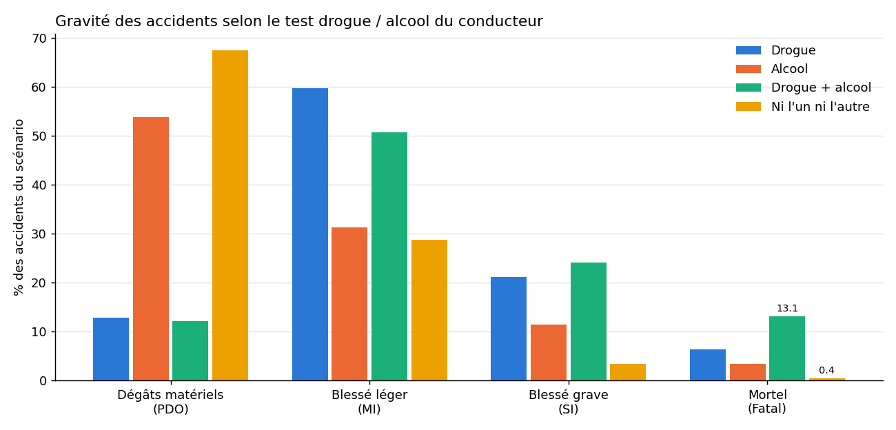

# Étude de cas — Analyse Big Data des accidents de la route avec PySpark

Cours *Fondements et Application de Big Data*. Reproduction critique de l'étude
[« Big Data Analysis of Road Crash Data using PySpark with PySpark Tutorial »](https://medium.com/rakesh-nain/big-data-analysis-of-road-crash-data-using-pyspark-with-pyspark-tutorial-c78ff2c35588)
(Rakesh Nain) : accidents de la route en Australie-Méridionale, 2012–2019, analysés avec les trois API de Spark (RDD, DataFrame, SQL).

**Le rendu est le notebook [`etude_cas_road_crash.ipynb`](etude_cas_road_crash.ipynb)** : problème, explications, code, tests,
comparaisons et conclusion.

Travaux précédents : [TP1 Hadoop MapReduce](https://github.com/battisteb/hadoop-wordcount-comparaison) ·
[TP2 Spark](https://github.com/battisteb/spark-wordcount-comparaison).

## Contenu du notebook

1. **Données** : 127 672 accidents (*Crash*) et 272 591 véhicules/usagers impliqués (*Units*), contrôle qualité.
2. **RDD** : chargement, partitionnement personnalisé (SA / autres États), âge moyen par sexe, véhicules les plus anciens et récents,
   et démonstration du piège du `split(',')` (16,7 % des lignes mal découpées).
3. **DataFrame** : requêtes de l'article, mortalité par type d'accident, conducteurs sans permis (jointure), **gravité selon drogue/alcool**.
4. **Mêmes requêtes avec les 3 API** : résultats identiques vérifiés, temps comparés.
5. **Pour aller plus loin** : évolution annuelle, heure × jour de la semaine, mortalité selon la vitesse autorisée.
6. **Tests** (pytest, mini jeu de données avec des cas pièges).
7. **Regard critique sur l'article** : 7 problèmes relevés, dont 3 qui produisent des chiffres faux sans erreur.
8. **Conclusion**.



| Scénario (test du conducteur) | accidents | part d'accidents mortels | risque relatif |
|---|---:|---:|---:|
| Ni drogue ni alcool | 122 137 | 0,42 % | ×1 |
| Alcool | 3 979 | 3,42 % | ×8 |
| Drogue | 1 854 | 6,31 % | ×15 |
| Drogue + alcool | 298 | 13,09 % | ×31 |

*Association, pas causalité : tous les conducteurs ne sont pas testés, surtout après un accident léger (biais de sélection, discuté dans le notebook).*

## Fichiers

```
etude_cas_road_crash.ipynb   le rendu
src/road_crash.py            chargement + chaque requête en 3 versions (RDD, DataFrame, SQL)
src/telecharger_donnees.py   télécharge les 16 CSV + métadonnées (≈ 77 Mo) dans data/
tests/test_road_crash.py     tests pytest
results/                     graphiques et temps mesurés
Dockerfile                   Python 3.12 + OpenJDK 17 + PySpark 4.2.0 + Jupyter
```

## Utilisation

```bash
python src/telecharger_donnees.py
docker build -t road-crash-pyspark:4.2.0 .
docker run --rm -v "%cd%:/work" road-crash-pyspark:4.2.0 python -m pytest -v tests
docker run --rm -p 8888:8888 -v "%cd%:/work" road-crash-pyspark:4.2.0 jupyter lab --ip=0.0.0.0 --allow-root --no-browser
```

**Données** : Department of Planning, Transport and Infrastructure (DPTI), South Australia — https://data.sa.gov.au.
Copie utilisée : dépôt de l'auteur de l'article, figé sur le commit `dab8e64`. Les données ne sont pas versionnées ici :
on les télécharge avec le script.
